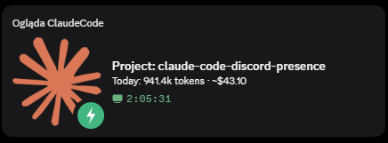
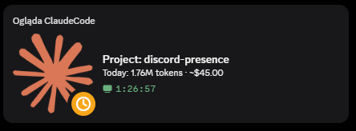

# Claude Code Discord Presence

[](https://github.com/MarcelBaka/claude-code-discord-presence/actions/workflows/test.yml)


Show what you are building with **Claude Code** on your Discord profile – the project, whether
Claude is working or waiting for you, the real number of tokens used, an estimated cost, the model
and a live timer.

<table align="center">
  <tr>
    <td align="center"><br><sub><b>Claude is working</b> – green badge</sub></td>
    <td align="center"><br><sub><b>Waiting for your prompt</b> – amber badge</sub></td>
  </tr>
</table>

<p align="center"><sub>The state line alternates between the session (<code>Editing files · 125.4k tokens · ~$2.31</code>) and today's totals; the badge shows whether Claude is working or waiting for you.</sub></p>

It starts by itself whenever you run Claude Code, follows the session you are actually using and
disappears when you close Claude. No bot, no account token, no dependencies and **nothing to set up
on Discord** – just the desktop Discord client's local RPC.

> Not affiliated with Anthropic or Discord.

## Features

- **Zero setup after install** – global Claude Code hooks start one small background process; no
  server to run, no autostart needed (Windows and macOS).
- **Real token usage** – read from the session transcript Claude Code writes, deduplicated per API
  response, subagents included. Never estimated from text length.
- **Working / waiting** – a small status badge and text show whether Claude is busy or waiting
  for your next prompt (also after you press Esc).
- **What Claude is doing** – `Thinking`, `Editing files`, `Reading code`, `Running commands`,
  `Browsing the web`, `Running agents`… instead of a plain “Working”. Only the kind of tool is
  shown, never file names, commands or URLs.
- **Estimated cost** at Anthropic API list prices, per model (Opus, Sonnet, Haiku, Fable…).
- **Model and effort** in the image tooltip, e.g. `Opus 5.5 · high effort`.
- **Today's totals** across all your sessions and projects, e.g. `Today: 1.2M tokens · ~$25`,
  rotating with the session line.
- **Project buttons** – an optional `View on GitHub` button for the projects you choose, plus a
  **Get this plugin** button so people who see your card can find this project.
- **Pause and Away** – `pause 1h` hides the card for a while; optionally the card says *Away* after
  you have not sent a prompt for a set time.
- **`doctor`** – one command that checks the usual reasons nothing shows on Discord and says what to do.
- **Native Discord timer** counting from when Claude Code was launched; it never resets on updates
  or reconnects.
- **Multiple sessions** – shows the session open in the Claude desktop app window, or the one you
  last typed in; switches when one closes, even after a terminal crash.
- **Claude desktop app aware** – hides when you close the window, shows `Chatting with Claude` in
  the regular chat tab (optionally from sign-in, without a Code session).
- **Updates** – one command, or automatically (opt-in); the price table refreshes itself daily.
- **Plays nicely with VS Code** – uses the “Watching” activity type, so it is shown next to (and
  below) the VS Code Discord extension instead of replacing it.
- **Private by design** – only the project name, token count, cost and timer are sent. Never
  prompts, code, file paths or repository URLs. Project names can be aliased or hidden.
- **Safe install** – backs up `settings.json`, never touches your existing hooks or status line,
  can be run again without creating duplicates, and uninstalls cleanly.

## Requirements

- **Windows 10/11**, or **macOS** on Apple Silicon or Intel
- The **Discord desktop app** (the browser version has no local RPC)
- **Claude Code** (CLI or the Claude desktop app's Code tab)
- **Node.js 18+** (macOS: Node 20+ recommended – from nodejs.org, Homebrew, nvm, fnm, volta…).
  The installer writes the absolute path of the Node it was run with into the hooks, so Claude
  does not need `node` on its `PATH` – the Claude desktop app and launchd start with a minimal one.
  On older macOS versions (e.g. macOS 13) Homebrew has no prebuilt Node and compiles it from
  source, which can take hours – use the installer from [nodejs.org](https://nodejs.org) instead.

### Platform support

| Platform | Status |
|---|---|
| Windows 10/11 x64 | Supported; real Discord and Claude verified by the author; CI: Node 18/20/22 |
| macOS, Intel (x64) | Supported; verified on macOS 13.7 Intel with a real Discord client – install, project/timer/tokens card, `update` and LaunchAgent autostart; full test suite locally and in CI (`macos-15-intel`, Node 22) |
| macOS, Apple Silicon (arm64) | Supported; CI `macos-latest` (Node 20/22/24) passes with a fake Discord IPC server; not yet checked with a real Discord on an M-series Mac |
| Linux | **Coming soon** – the code paths exist (sockets, `ps`, XDG/Flatpak/Snap Discord sockets) but are not tested or supported yet |
| WSL | Not supported |

See [`docs/reports`](docs/reports) for exactly what was verified with a real Discord client.

## Quick start

### 1. Install

**Easiest – download the installer** from the
[latest release](https://github.com/MarcelBaka/claude-code-discord-presence/releases/latest)
(install [Node.js 18+](https://nodejs.org) first):

- **macOS:** `claude-code-discord-presence-<version>-macos.zip` → unzip → double-click
  `install-macos.command`. The first time, macOS may block a downloaded script: right-click it →
  **Open** → **Open**.
- **Windows:** `claude-code-discord-presence-<version>-windows.zip` → Extract All → double-click
  `install-windows.cmd` (SmartScreen: **More info** → **Run anyway**).

The installer finds Node (also Homebrew/nvm/volta installs on macOS), asks for a Discord
Application ID – **just press Enter** to use the built-in “ClaudeCode” app – installs and optionally
turns on start at sign-in. The scripts
are not code-signed; they only run `node install.js` from the unzipped folder.

**Or from the command line:**

**Windows** (PowerShell):

```powershell
git clone https://github.com/MarcelBaka/claude-code-discord-presence.git
cd claude-code-discord-presence
node install.js
```

**macOS** (Terminal):

```bash
git clone https://github.com/MarcelBaka/claude-code-discord-presence.git
cd claude-code-discord-presence
node install.js
```

No `git`? Download the ZIP from GitHub (Code → Download ZIP), unpack it and run
`node install.js` inside the folder. No `sudo` is needed; everything goes to
`~/.claude/discord-presence` and `~/.claude/settings.json`.

### 2. Restart Claude Code

Restart any open Claude Code sessions so they load the new hooks. That's it – the activity
appears on your profile as soon as a session starts or you send a prompt.

Check what is being sent at any time:

```powershell
node "$env:USERPROFILE\.claude\discord-presence\cli.js" status
```

```bash
node ~/.claude/discord-presence/cli.js status
```

## Commands

Windows (PowerShell) / macOS (Terminal):

```powershell
node "$env:USERPROFILE\.claude\discord-presence\cli.js" <command>
```

```bash
node ~/.claude/discord-presence/cli.js <command>
```

| Command | What it does |
|---|---|
| `status` | Diagnostics: exact activity payload, Discord connection, sessions, token source and breakdown (`--json` for JSON) |
| `disable` / `enable` | Turn the integration off (clears the activity) / back on |
| `set-app-id <ID>` | Use your own Discord application (see [Your own Discord application](#your-own-discord-application-optional)) |
| `set-app-id default` | Back to the built-in “ClaudeCode” application |
| `alias <folder> <name>` | Show a custom project name, e.g. `alias my-web-app "My Web App"` |
| `hide [<folder>]` / `unhide [<folder>]` | Hide one project name, or all of them (“Project hidden”) |
| `cost on\|off` | Show or hide the estimated cost |
| `status-icon on\|off` | Show whether Claude is working or waiting for you |
| `model on\|off` | Model and effort in the image tooltip |
| `today <rotate\|tooltip\|off>` | Today's totals: alternate with the session line every 20 s, show in the tooltip, or hide |
| `link <folder> [url]` | Add a button for a project; without a URL the Git `origin` remote is used |
| `unlink <folder>` | Remove the button |
| `autostart on\|off` | Start at sign-in – Windows Startup folder or a macOS LaunchAgent (optional) |
| `mac-accessibility on\|off` | macOS: opt-in Accessibility detection of minimized vs. closed windows |
| `activity on\|off` | Show what Claude is doing (Editing files, Running commands…) |
| `version` | Installed version and the latest release on GitHub |
| `update [--force]` | Install the latest **release** from GitHub (keeps your config); does nothing if you already have it |
| `update --main` | Install the `main` branch (unreleased changes) |
| `update <version>` | Install a specific release, e.g. `update 1.1.0` – also to go back to an older one |
| `update-check on\|off` | Check GitHub once a day for a newer release (shown in `status`) |
| `auto-update on\|off` | Install new releases automatically, only while Claude is not working (off by default) |
| `doctor` | Check Node, hooks, Discord, the background process, sessions and the log – with fixes |
| `pause [duration]` | Hide the card for a while: `30m`, `1h` (default), `2h30m`, `90` (minutes), `forever` |
| `resume` | Show the card again |
| `away <minutes\|off>` | Say *Away* after that long without a prompt (off by default) |
| `promo on\|off` | The *Get this plugin* button on your card |
| `prices` | Date of the price table used for the cost estimate |
| `chat on\|off` | Show or hide the activity in the regular Claude chat tab |
| `type <watching\|playing\|competing\|listening>` | Discord activity type (see [VS Code](#using-it-with-the-vs-code-discord-extension)) |
| `tokens <no_cache_read\|all\|output>` | What the token counter includes (see [Tokens](#how-tokens-are-counted)) |
| `scope <launch\|conversation>` | Count since Claude was launched (default) or the whole conversation |
| `language <en\|pl>` | Language of the text on Discord |
| `image <auto\|key\|url\|none>` | Activity image: app icon (default), Art Asset key, image URL, or none |
| `count <file.jsonl> [since]` | Count tokens and cost in any transcript (for verification) |
| `project [dir]` | Preview the project name Discord will see |
| `stop` / `logs` | Stop the background process / show recent log lines |

## Configuration

Settings live in `%USERPROFILE%\.claude\discord-presence\config.json` (macOS:
`~/.claude/discord-presence/config.json`) and are picked up live.
The commands above edit it for you; [`config.example.json`](config.example.json) shows every key.

| Key | Default | Meaning |
|---|---|---|
| `enabled` | `true` | Master switch |
| `applicationId` | `""` | Your own Discord Application ID; empty = the built-in “ClaudeCode” app |
| `language` | `"en"` | `en` or `pl` |
| `aliases` | `{}` | `{ "folder-name or full path": "Display name" }` |
| `hideProject` / `hiddenProjects` | `false` / `[]` | Hide all / selected project names |
| `tokenCount` | `"no_cache_read"` | `no_cache_read`, `all` or `output` |
| `tokenScope` | `"launch"` | `launch` or `conversation` |
| `includeSubagents` | `true` | Count subagent usage |
| `showCost` | `true` | Append the estimated cost |
| `showStatus` | `true` | Working/waiting text and badge |
| `showActivity` | `true` | What Claude is doing instead of a plain “Working” |
| `checkUpdates` | `true` | Daily check for a newer release on GitHub |
| `autoUpdate` | `false` | Install new releases automatically (`auto-update on`) |
| `updatePrices` | `true` | Refresh the price table from this repository once a day |
| `promoButton` | `true` | *Get this plugin* button linking to `updateRepo` |
| `awayAfterMinutes` | `0` | Minutes without a prompt before the card says *Away* (0 = off) |
| `pausedUntil` | `0` | Set by `pause` / `resume` (time in ms, `-1` = until resume) |
| `showModel` | `true` | Model and effort in the image tooltip |
| `showToday` | `"rotate"` | `rotate`, `tooltip` or `off` |
| `links` | `{}` | `{ "folder-name or full path": "https://…" }` – project buttons |
| `autostart` | `false` | Start at sign-in (set with `autostart on`) |
| `assetBaseUrl` | this repo's `assets/` | Where the status badges are loaded from |
| `updateRepo` | this repo | `owner/name` used by `update` |
| `pricing` | `{}` | Price overrides, e.g. `{ "claude-opus-5-5": { "input": 4, "output": 20 } }` |
| `activityType` | `"watching"` | `watching`, `playing`, `competing`, `listening` |
| `showChat` | `true` | Activity in the Claude desktop app's chat tab |
| `hideWhenWindowClosed` | `true` | Hide when the Claude desktop window is closed |
| `macAccessibility` | `false` | macOS: use Accessibility (System Events) to tell minimized from closed windows |
| `largeImageKey` / `largeImageText` | `""` / `"Claude Code"` | Image (empty = app icon) and its tooltip |
| `showSessionCount` | `false` | Append the number of open sessions |
| `logMaxBytes` | `524288` | Log size before rotation |

## Your own Discord application (optional)

Out of the box the card uses the built-in **ClaudeCode** Discord application, so the title reads
“Watching **ClaudeCode**” with its icon and there is nothing to configure. An Application ID is a
public identifier – anyone who sees the card can read it – not a password or token, and it gives
nobody access to your account.

Want your own title or icon?

1. Open the [Discord Developer Portal](https://discord.com/developers/applications) → **New Application**.
2. Pick a name – it is shown as the activity title. Discord rejects some names containing
   “Claude” (e.g. with a space); `ClaudeCode` works.
3. *(Optional)* Upload an **App Icon** on **General Information** – it becomes the card image.
4. Copy the **Application ID** and run `cli.js set-app-id <ID>` (or paste it into the installer).

`cli.js set-app-id default` switches back to the built-in application.

## Working, waiting, model and today

- **What Claude is doing** comes from the `PreToolUse` hook: `Edit`/`Write` → *Editing files*,
  `Read`/`Grep`/`Glob` → *Reading code*, `Bash`/`PowerShell` → *Running commands*,
  `WebSearch`/`WebFetch`/browser tools → *Browsing the web*, `Task`/`Agent` → *Running agents*,
  to-do and plan tools → *Planning*, other tools (MCP…) → *Using tools*; right after a prompt it
  says *Thinking*. The hook keeps only that category – the tool's input (file names, commands,
  URLs, queries) is never stored, logged or sent. It runs as an `async` hook, so Claude never
  waits for it. `activity off` turns it off (the hook then exits immediately).
- **Working** starts when you send a prompt; **Waiting** when Claude finishes its reply (`Stop`
  hook), asks for your input (`Notification`), or you interrupt it with Esc (detected from the
  transcript, since no hook fires then). After 15 minutes without a reply or a hook, a stuck
  “Working” falls back to “Waiting”. The badge images live in [`assets/`](assets) and are loaded
  by Discord from GitHub.
- **Model and effort** come from the latest reply in the transcript (`message.model`, `effort`).
- **Today** sums every Claude Code transcript changed since local midnight – all projects, closed
  sessions and subagents too – with the same deduplication and token/cost rules as the session.

## Project buttons

```powershell
node "$env:USERPROFILE\.claude\discord-presence\cli.js" link C:\path\to\my-site
```

adds a **View on GitHub** button for that project (the URL comes from its `origin` remote; any
credentials in it are dropped). Only link public pages – the button is visible to everyone. Hidden
projects never get a button. Discord shows buttons to other people, not on your own view of your
profile.

The card also shows a **Get this plugin** button linking to this repository, so people who see it
can install it too (next to a project's own button – Discord allows two). `promo off` removes it.

## Pause and Away

- `pause` hides the card for an hour (`pause 30m`, `pause 2h30m`, `pause forever`) – e.g. for a
  meeting or a stream – and it comes back by itself; `resume` shows it at once. The timer and the
  counters are not reset. `status` says when the pause ends.
- `away 30` makes the card say **Away** after 30 minutes without a prompt (badge tooltip: *Away –
  waiting for a prompt*); the next prompt switches back to *Thinking*. Off by default – waiting is
  never treated as closing Claude.

## Autostart (optional)

By default the background process is started by Claude Code hooks – nothing runs at sign-in.
`autostart on` also starts it at sign-in and keeps it running in standby (a few MB of memory).
`autostart off` or uninstalling removes it; re-running the installer updates its paths.

- **Windows:** adds `Claude Code Discord Presence.vbs` to your Startup folder (`shell:startup`),
  which launches Node with no window. Opening the Claude desktop app straight into a chat then
  shows `Chatting with Claude` right away.
- **macOS:** writes a user LaunchAgent,
  `~/Library/LaunchAgents/io.github.marcelbaka.claude-code-discord-presence.plist` (no `sudo`),
  and loads it with `launchctl bootstrap gui/$UID`. It has absolute paths, its own minimal
  environment (no shell profile), `RunAtLoad` and **no** `KeepAlive`, so a process you stopped
  is not restarted, and an instance started while one already runs simply exits. `autostart off`
  unloads (`launchctl bootout`) and deletes only this file. The `Chatting with Claude` card is
  Windows-only (see below).

  Check it with:

  ```bash
  launchctl print gui/$(id -u)/io.github.marcelbaka.claude-code-discord-presence
  ```

  `state = running` means the standby process was started by launchd. `state = not running` with
  `last exit code = 0` is also fine: another instance (started by a Claude Code hook) was already
  running, so the one from launchd exited instead of starting a second process.

## Updating

```powershell
node "$env:USERPROFILE\.claude\discord-presence\cli.js" version
node "$env:USERPROFILE\.claude\discord-presence\cli.js" update
```

```bash
node ~/.claude/discord-presence/cli.js version
node ~/.claude/discord-presence/cli.js update
```

`version` shows the installed version and the latest release. The background process also checks
once a day and `status` then says `Update available: 1.2.0 (installed 1.1.0)`. The check is one
anonymous request to the public GitHub API (`api.github.com/repos/<repo>/releases/latest`) – no
token and no data about you or your sessions; `update-check off` disables it.

`update` installs the **latest published release** (its tag), not the `main` branch, so you only
get tested, released versions; if you already have it, nothing happens (`--force` reinstalls).
`update --main` takes the unreleased `main` branch, `update 1.0.1` a specific release (also to go
back). It downloads that version as a ZIP, unpacks it with a system tool
(the built-in `tar.exe` on Windows 10/11, `ditto` on macOS, `unzip` on Linux – arguments are passed directly,
never through a shell string), runs its installer and keeps your configuration and Application ID.
A failed download, unpack or install is reported as a failure (exit code 1) and the temporary files
are removed either way. From a clone, `git pull` followed by `node install.js` does the same.

**Automatic updates** (`auto-update on`, off by default): when the daily check finds a newer
release, the background process installs it with `update --auto` – only while no Claude session is
working, at most once a day per version – and starts the new version. The output goes to
`logs/auto-update.log`. Releases are tested on Windows and macOS before they are published.

## How it works

```
claude ──hooks──▶ hook.js ──event file──▶ daemon.js ──local IPC──▶ Discord desktop
 (SessionStart, UserPromptSubmit,          │  ▲
  PreToolUse, Stop, Notification,          │  │
  CwdChanged, SessionEnd)                  │  └─ window-watch.ps1 / window-watch-mac.jxa (desktop app)
                                           └──── session transcript (.jsonl) → tokens & cost
```

- **`hook.js`** runs on seven Claude Code events. It prints nothing (so nothing reaches Claude's
  context), records the session id, transcript path and project folder, starts the background
  process if needed and exits in ~0.2 s.
- **Hook command.** Claude Code runs hooks through a shell (`sh -c` on macOS/Linux, Git Bash or
  PowerShell on Windows). On macOS every path is written in POSIX single quotes (a `'` becomes
  `'\''`), so install paths with spaces, apostrophes, `$`, backticks, `!`, quotes or non-ASCII
  characters reach Node unchanged.
- **`daemon.js`** is a single background process. It keeps a registry of sessions, checks that each
  Claude process is still alive, reads transcripts incrementally and sends `SET_ACTIVITY` to
  Discord – only when something changed, at most 5 times per 20 s, with reconnects backing off from
  2 s to 60 s; the timer never resets on reconnect.
- **One instance.** Windows: a per-user named pipe. macOS/Linux: a Unix socket in the private
  `state/` folder (or, if that path is longer than the 104-byte socket limit, in a per-user `0700`
  folder `/tmp/cdp-<uid>/`). Starting, probing and removing a socket left behind by a crash all
  happen under one short lock, and only a socket owned by you is removed – simultaneous hook
  starts never delete a running (or just-starting) instance's socket. All state files are created owner-only.
- **Which process is Claude?** First Claude Code's own registry (`~/.claude/sessions/<pid>.json`).
  If it has no entry, the hook records its ancestors with `ps` (the shell that ran it exits right
  away) and the daemon picks the Claude process – the native `claude` binary (also the copy bundled
  with the Claude desktop app) or Node running `@anthropic-ai/claude-code` – never the hook's shell.
  On macOS the process start time is compared with the one Claude recorded and re-checked every
  15 s, so a PID reused by another program never keeps a closed session on your profile.
- **Discord socket (macOS/Linux).** `discord-ipc-0` … `discord-ipc-9` in every candidate
  directory: `$XDG_RUNTIME_DIR`, `$TMPDIR`, `$TMP`, `$TEMP`, the per-user temporary folder macOS
  assigns (`getconf DARWIN_USER_TEMP_DIR`, used when the process was started without `TMPDIR`) and
  `/tmp` (plus Flatpak/Snap folders on Linux), deduplicated.
- **Project name** = the Git repository's root folder (Git worktrees resolve to the main repo),
  otherwise the working directory's name. Only the name is ever published.

## How tokens are counted

- **Source:** the JSONL transcript Claude Code passes to hooks (`transcript_path`) plus subagent
  transcripts. Each API response is an `assistant` record with `message.id` and `message.usage`.
- Claude Code writes one line per content block (thinking, text, tool call), all with the same
  usage, so usage is keyed by `message.id` and **counted once**. Responses copied into another file
  (resume, fork) are counted once too.
- Partial lines wait until they are complete; rewritten files are recounted without duplicates.
- **Default counter** = input + cache writes + output – the tokens the model newly processed.
  Cache reads (the same context re-read on every call, often 95%+ of the total) are excluded;
  `tokens all` includes them.
- **Default scope** = since the current Claude process started, so resuming an old conversation
  does not add its history. `/clear` in the same window keeps counting.
- The status line's `context_window` values are **not** used – they describe the current context
  size, not usage over the session.
- No transcript → `Tokens: no data`, never a fake zero.

## Estimated cost

- Every response is priced by its own model using **all** usage components: input, output, cache
  reads and cache writes (5-minute and 1-hour priced separately). Fast mode counts 2×.
- Prices are Anthropic's API list prices in [`app/pricing.json`](app/pricing.json), e.g. Opus 5.5:
  $4 input / $20 output / $0.20 cache read per million tokens. The background process refreshes
  that file from this repository's `main` branch once a day, so a new model gets a price without
  a new release: only plain numbers and simple model names are accepted, and a table older than
  the installed one is ignored. `prices` shows the date in use; `updatePrices: false` turns it off.
- **This is the API-equivalent value, not your bill** – Pro/Max subscriptions are not charged per
  token. Responses from models without a known price are left out and marked with `+`.

## Using it with the VS Code Discord extension

Discord displays only one **“Playing”** activity at a time, and the popular VS Code extension uses
“Playing”. This integration therefore defaults to **“Watching”**: both cards are visible on your
profile, VS Code is listed first and stays the status under your name. Prefer Claude on top?
`type competing`. Want them to compete for one slot? `type playing`.

## Claude desktop app

**Windows**

- **Window closed** (the app keeps running in the tray): the activity is hidden within ~2 s and
  comes back with the same timer when you reopen the window. A minimized window still counts.
- **Regular chat tab**: the card switches to `Chatting with Claude` with its own timer. Chats have
  no local transcript, so there are no tokens or cost for them.
- **Switching sessions in the app** switches the card at once: the window's title is matched to the
  session name Claude Code stores in `~/.claude/sessions`. Merely resuming old sessions (clicking
  through the sidebar, or the app restoring them) does not take the card over; a later prompt in a
  terminal session still wins over a window left open.
- All this is detected by a small PowerShell watcher using the Windows window list and UI
  Automation. The open session's title is used only for that match, kept in memory and never sent
  to Discord, written to the status file or logged.

**macOS** – a small JavaScript-for-Automation watcher (`osascript`) runs while a desktop-app
session is open. What can be detected:

| | Without permissions (default) | With `mac-accessibility on` |
|---|---|---|
| Claude app running | ✔ | ✔ |
| App hidden (⌘H) – counts as open | ✔ | ✔ |
| Window on screen | ✔ | ✔ |
| Minimized vs. closed (⌘W, app stays in the Dock) vs. on another Space | ✘ – shown as `unknown`, the card stays | ✔ – only a closed window hides the card |
| Code vs. chat tab | ✘ – the chat card is not shown | ✘ – not detectable: the window title is always “Claude” (checked with Claude 2.1.330) and the page content is not exposed to Accessibility |

The CLI presence never depends on this: a refused permission, a missing watcher or an unknown
state never hides a session, and the watcher asks at most once (no loops). The tab is never guessed
from the app merely running. The window title is used only to match the open session to Claude's
session list on your computer; it is never sent, stored or logged. Conversation content is never read.

To enable the extra detection:

1. `node ~/.claude/discord-presence/cli.js mac-accessibility on`
2. **System Settings → Privacy & Security → Accessibility**: add (**+**) and switch on the app that
   starts the background process – **Claude** (Claude Code in the desktop app), **Terminal** or
   iTerm (`claude` in a terminal) and, with autostart, the **node** binary the installer uses
   (⌘⇧G, e.g. `~/.local/opt/node-v22…/bin/node` or `/opt/homebrew/bin/node`). If macOS asks
   to let it control **System Events**, allow that too.
3. Restart the background process (a refusal is remembered until then, so you are never asked in
   a loop): `cli.js stop`, then the next Claude event – or with autostart
   `launchctl kickstart gui/$(id -u)/io.github.marcelbaka.claude-code-discord-presence`.

`cli.js status` shows whether Accessibility was granted (`ok`), refused (`denied`, error
`-25211`) or is `off`.

## Privacy

Sent to Discord: project name or alias (or “Project hidden”), Claude's working/waiting state,
token counts (session and today), estimated cost, model and effort, start time, images, and the
project buttons you add yourself plus the *Get this plugin* link (`promo off`). **Never** prompts, responses, file contents, paths or repository URLs. The hook
does not read prompt text, and nothing in this project ever calls a model.

The app icon is looked up once from Discord's public application endpoint using only your public
Application ID. The daily update check asks the public GitHub API for the latest release of this
repository (no token, nothing about you; `update-check off`), and the price table is read from
the repository the same way (`updatePrices: false`). Local diagnostics (`state\`, size-limited `logs\`) stay on your machine; on
macOS they, and the daemon socket, are readable by your user only.

## Troubleshooting

| Problem | Try |
|---|---|
| Anything | Run `cli.js doctor` first – it checks the usual causes and prints what to do. |
| Nothing on Discord | `cli.js status` – check `Discord: connected` and the payload. Make sure *Settings → Activity Privacy → Share your activity* is on in Discord. |
| `Discord is not running` | Start the Discord desktop app; the integration reconnects by itself. |
| `Invalid Client ID` in `logs` | Your own Application ID is wrong – re-copy it (`cli.js set-app-id <ID>`) or go back to the built-in app: `cli.js set-app-id default`. |
| Only VS Code is visible | Use the default type: `cli.js type watching`. |
| Old app name or icon | Restart Discord (`Ctrl+R`); after changing the icon run `cli.js stop`. |
| Hooks not firing | Restart Claude Code; re-run `node install.js` (safe to repeat). |
| macOS: hooks fail after a Node upgrade / switching nvm versions | Re-run `node install.js` with the Node you want to use (Homebrew installs use the stable `/opt/homebrew/bin/node`-style link automatically). |
| macOS: `Discord is not running` although it is | `ls "$(getconf DARWIN_USER_TEMP_DIR)"discord-ipc-*` should list a socket; restart Discord if not. |
| macOS: card stays when the desktop window is closed | Expected without Accessibility (see [Claude desktop app](#claude-desktop-app)); `cli.js mac-accessibility on`. |

## Uninstall

```powershell
node "$env:USERPROFILE\.claude\discord-presence\uninstall.js"
```

```bash
node ~/.claude/discord-presence/uninstall.js
```

Clears the activity, stops the background process, removes the autostart entry (Startup-folder
file or our LaunchAgent only), removes **only** this project's hooks from `settings.json` (after a
backup; other hooks and your `statusLine` stay) and deletes the install folder. Add `--keep-files`
to keep the configuration.

## Development

```bash
node --test test/unit.test.js test/integration.test.js
```

Unit tests cover token counting, pricing, project names, `settings.json` merging, hook-command
quoting, socket discovery, `ps` parsing, the single-instance lock, the macOS window states, the
LaunchAgent and the updater. End-to-end tests run the real `hook.js` and `daemon.js` against a fake
Discord IPC server and fake Claude processes – named pipes on Windows, real Unix sockets on macOS:
concurrent starts, a daemon killed with `SIGKILL`, Discord restarts, multiple projects, crashes,
PID lookup through the real process tree, PID reuse, `/clear`, closing the window, the chat tab,
working/waiting (including Esc), today's totals, buttons, autostart, install → reinstall →
uninstall. Platform-specific cases are skipped explicitly with a reason.
GitHub Actions runs them on Windows (Node 18/20/22), macOS Apple Silicon (Node 20/22/24) and macOS
Intel (Node 22). See [`docs/reports`](docs/reports) for the verification reports.

### Releases

Pushing a tag such as `v1.2.3` runs the tests on Windows and macOS and then publishes a GitHub
Release with two downloads built by [`tools/build-release.js`](tools/build-release.js) (plain Node,
no dependencies): a macOS ZIP with the executable `install-macos.command` and a Windows ZIP with
`install-windows.cmd` (CRLF). Build them locally with `node tools/build-release.js 1.2.3`.

To release: bump [`app/version.json`](app/version.json), add a section for that version to
[`CHANGELOG.md`](CHANGELOG.md), merge, then push the matching tag (`v` + that version). The
release notes are that CHANGELOG section, the download instructions and GitHub's list of merged
pull requests; a tag without a CHANGELOG entry is refused. The release workflow refuses a tag that does not match `app/version.json`,
so `cli.js version` and the update check always agree with the published release.

### Known limitations

- The model call made by `/compact` itself is not in the transcript, so it is not counted.
- Without `autostart on`, opening the desktop app straight into a chat shows nothing until the
  first Claude Code event.
- Chat-tab detection relies on the Claude app's page title; an app update could change it.
- macOS: without Accessibility, a minimized window, a window on another Space and a closed window
  look the same (the card stays). The Code/chat tab cannot be detected on macOS at all, so the
  `Chatting with Claude` card is Windows-only.

## License

[MIT](LICENSE)
